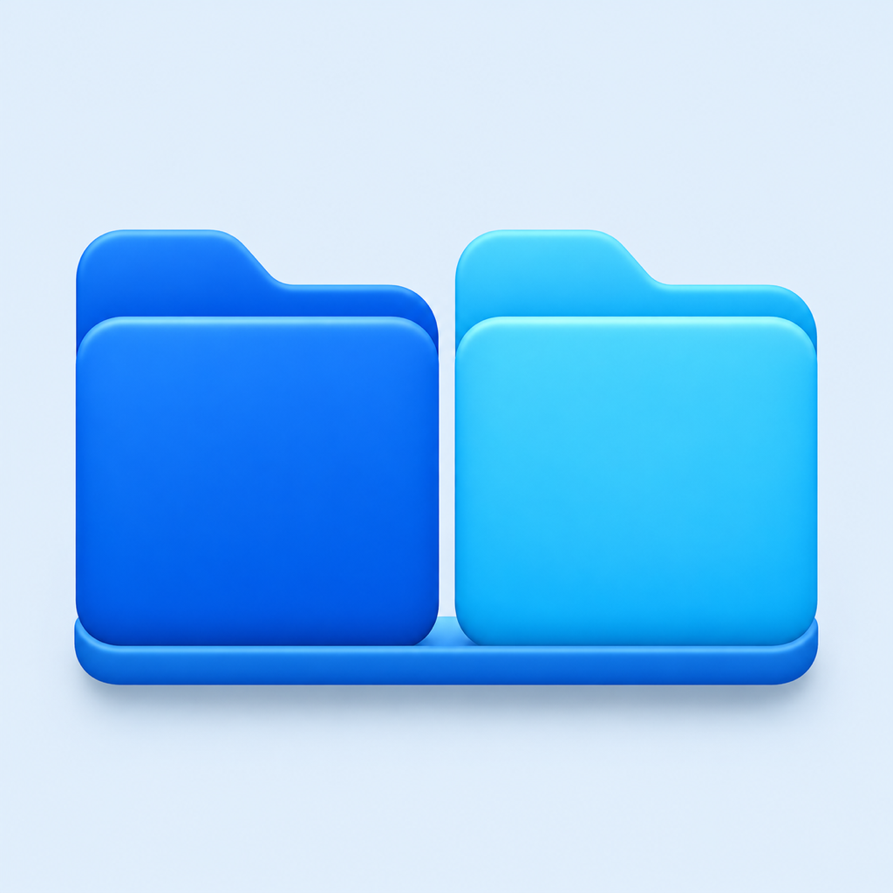

  

# FileDock

**A native two-pane file manager for Apple Silicon Macs.**

FileDock keeps two folders open side by side so you can browse, copy, move, rename, preview, and organize files without opening multiple Finder windows.

## Download

[Download the latest public release](https://github.com/svmark/FileDock/releases)

The first public build is **FileDock 0.13.4 Public Beta**. It is signed with a Developer ID certificate issued to SNDWorks Co., Ltd. and notarized by Apple.

## Requirements

- Apple Silicon Mac (M-series)
- macOS 15 or later
- Tested on macOS 26 and 27
- Korean and English interface

Intel Macs are not supported in the current build.

## Highlights

- Two folder panes in one native macOS window
- Copy and move between panes by toolbar, keyboard, or drag and drop
- Quick Look, rename, duplicate, trash, undo, and new-folder actions
- One-pane mode with state restoration
- Favorites, removable volumes, and Google Drive desktop folders
- List sorting, hidden-file toggle, path navigation, and recent folders
- No account, analytics, advertising, or telemetry

## Install

1. Download `FileDock-0.13.4.dmg` from [Releases](https://github.com/svmark/FileDock/releases).
2. Open the DMG and drag **FileDock** to **Applications**.
3. Open FileDock from Applications or Spotlight.
4. Choose **Open** if macOS displays the standard downloaded-app confirmation.
5. Allow access when macOS asks for permission to open Desktop, Documents, Downloads, or removable volumes.

See [INSTALL.md](INSTALL.md) for permissions, updates, and removal.

## Privacy

FileDock works on the Mac itself. It does not collect analytics, upload files, or connect to a FileDock account or service. Google Drive integration only opens folders made available locally by Google Drive for desktop. See [PRIVACY.md](PRIVACY.md).

## Source and terms

FileDock is proprietary freeware. The source code is not published. Official, unmodified releases may be used free of charge for personal, educational, and business purposes. See [TERMS.md](TERMS.md).

Please share the official Releases page instead of re-uploading or repackaging the app.

## Feedback

Use [GitHub Issues](https://github.com/svmark/FileDock/issues) for reproducible bugs and feature requests. Do not include private file names, paths, account names, or confidential screenshots.

---

## 한국어 안내

FileDock은 Apple Silicon Mac용 네이티브 2분할 파일 탐색기입니다. 한 창에 두 폴더를 나란히 열고 파일을 복사·이동·정리할 수 있습니다.

- 다운로드: [GitHub Releases](https://github.com/svmark/FileDock/releases)
- 지원: Apple Silicon, macOS 15 이상
- 검증 환경: macOS 26·27
- 언어: 한국어·영어
- 계정·광고·사용 통계·텔레메트리 없음
- 소스 코드는 공개하지 않으며 앱은 무료로 제공합니다.

설치와 권한 설명은 [INSTALL.md](INSTALL.md), 개인정보 처리 방식은 [PRIVACY.md](PRIVACY.md)를 참고하십시오.
